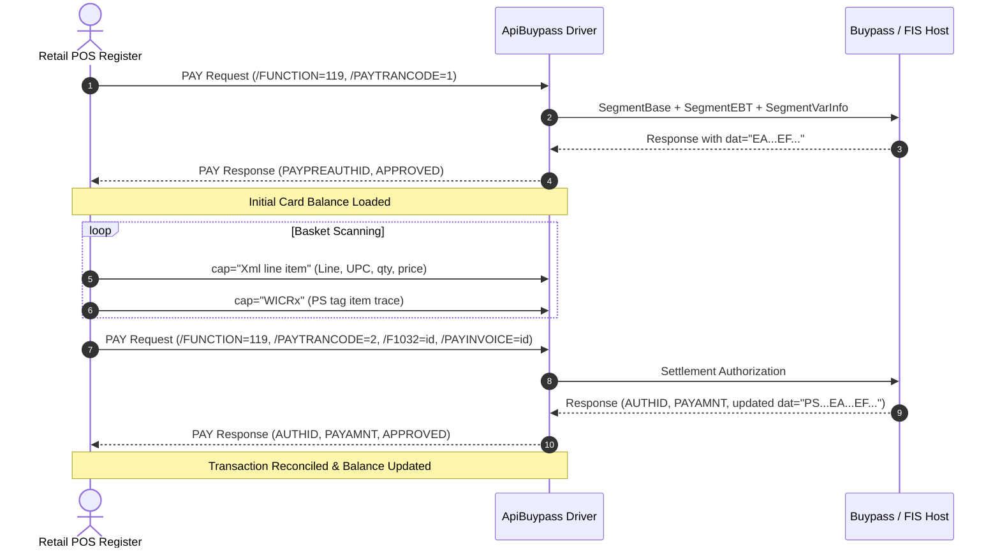

# RapscallionEWicParser (Rapscallion E-WIC Parser)

A high-performance Sublime Text 4 plugin package to decode, inspect, and reconcile **Electronic WIC (E-WIC)** transactions from retail POS log files (`*.sls`, `*.sl4`). Supports **Buypass / FIS**, **RBSLynk ISO**, and **WinEPS** banking processors, with automatic driver detection and dynamic reporting.

---

## Features

1. **Multi-Bank Processor Support (Buypass / FIS, RBSLynk ISO, & WinEPS)**:
   - Automatically detects the active banking driver from log headers and response tokens (`ApiBuypassIP`, `ApiRBSLynkISO`, `ApiWinEps`, `/PAYMENT=WINEPS`, `/PAYHOSTNAME=WE`, etc.).
   - Parses bank-specific pre-authorization structures (e.g., standard 6-digit approval codes, RBSLynk composite ISO tokens with STAN extraction, and WinEPS balance tags).
   - Generates dynamically-branded audit reports titled to the active processor.
2. **Purchase Settlements & Standalone Balance Inquiries**:
   - Accurately correlates purchase settlement cycles (`PAYTRANCODE=2`) with initial inquiry balances and scanned line items.
   - Audits standalone WIC balance inquiries (`PAYTRANCODE=6` or `1`, `/PRN=TRS_POS_Bank_eWIC_Inquiry`, `[SMSPayStatus] EA014...`) where no retail basket purchase took place.
3. **Version Compatibility (V3 `.sls` & V4 `.sl4`)**:
   - Out-of-the-box support for V3 XML-style POS logs (`*.sls`).
   - Prepared architecture and file-type recognition for upcoming V4 logs (`*.sl4`).
4. **Targeted Transaction Auditing by Invoice #, Sequence #, or Auth ID (`ewic_analyze_transaction_by_id`)**:
   - Pre-populates the prompt if digits are currently highlighted in your editor view.
   - Filters the entire log buffer and correlates the settlement cycle or standalone inquiry by Invoice #, Sequence #, or Authorization ID.
5. **Full Log Transaction Auditing (`ewic_audit_log`)**:
   - Discovers and reconstructs all E-WIC cycles present in the active log buffer in chronological order.
6. **Interactive APL Catalog Selection & Fallback**:
   - Prompts with a Sublime Text Quick Panel listing discovered `*.apl` and `*apl*.txt` files in the open file's folder and workspace project paths.
   - Offers native OS file browsing dialog to locate arbitrary APL files.
   - Retains active APL catalog across the window session for instant re-audits.
   - Includes standard **USDA Fallback** (`01` Formula, `02` Cheese/Tofu, `03` Eggs, `05` Adult Cereal, `06` Legumes, `08` Fish, `19` Whole Grains, `50` CVB Produce, `52` Infant Produce, `54` Infant Cereal).
7. **Quick Selection TLV Parser (`ewic_parse_selection` / `ctrl+alt+w`)**:
   - Instantly decodes highlighted text or the active cursor line containing `dat="EA..."` (including bracketed status prefixes like `[SMSPayStatus]`) into a formatted balance breakdown table.
8. **Source Log Line Numbers & Chronological Event Trace**:
   - Every basket item and transaction milestone records its 1-based log line number (`670`, `614`, etc.) and log timestamp without prefixes, allowing instant double-click selection and copy to jump directly in Sublime Text (`Ctrl+G`).
9. **Nationwide Multi-State Support**:
   - Strips state prefixes (e.g. `142` for Nevada / `NZ`) and dynamically auto-detects 14-digit, 13-digit, and 11-digit `EA` schemas with cross-referencing against `WIC_CATLIST`.
10. **Configurable Clipboard Export & Browser View**:
   - Generates audit results in a dedicated Markdown scratch tab.
   - Context-sensitive **View in Web Browser** command renders responsive HTML5 tables with print styling.
   - Optionally copies a clean Markdown reconciliation table directly to the system clipboard (configurable via settings).

---

## Keybindings & Key Chords

All commands feature intuitive key chords prefixed by **`Ctrl+Alt+W`** (macOS: **`Super+Alt+W`**):

| Key Chord | Alternate / Direct | Command Caption | Purpose |
| :--- | :--- | :--- | :--- |
| `Ctrl+Alt+W, S` | `Ctrl+Alt+W` | **WIC: Parse Selected TLV Balance String** | Parse cursor line or highlighted `dat="EA..."` string |
| `Ctrl+Alt+W, I` | *(Palette / Menu)* | **WIC: Analyze Transaction by Invoice / Sequence / Auth #** | Targeted audit by Invoice, STAN/Sequence, or Auth ID |
| `Ctrl+Alt+W, F` | *(Palette / Menu)* | **WIC: Audit All Transactions in Log** | Audit all E-WIC transactions in active log buffer |
| `Ctrl+Alt+W, B` | *(Palette / Menu)* | **WIC: View Report in Browser** | Open report in system web browser with responsive tables |
| `Ctrl+Alt+W, D` | *(Palette / Menu)* | **WIC: Set Report Output Destination…** | Quick switcher (Markdown / Browser / Both) |
| `Ctrl+Alt+W, L` | *(Palette / Menu)* | **WIC: Load APL Catalog File…** | Explicitly browse and cache an APL catalog file |
| `Ctrl+Alt+W, C` | *(Palette / Menu)* | **WIC: Clear Active APL Cache** | Reset the window's session-cached APL catalog |

> [!NOTE]
> All WIC commands are also accessible directly by right-clicking anywhere in Sublime Text under **Rapscallion Tools > E-WIC Log Parser**.
> Customize keybindings via **Preferences > Package Settings > Rapscallion E-WIC Parser > Key Bindings**.

---

## Log Correlation Mechanics

Buypass / FIS E-WIC transactions execute in asynchronous phases across the POS log:



---

## Configuration Settings

Access settings via **Preferences > Package Settings > Rapscallion E-WIC Parser > Settings**:

```json
{
    // Where to open generated audit reports:
    //  - "markdown" : Open only as a Markdown document in a Sublime Text tab (Default)
    //  - "browser"  : Open only in your system default web browser (no Sublime tab)
    //  - "both"     : Open in both a Sublime Text Markdown tab AND the web browser
    "report_destination": "markdown",

    // Backward-compatibility alias for "both"
    "auto_open_in_browser": false,

    // Whether to automatically copy the clean Markdown reconciliation table to the clipboard
    "auto_copy_to_clipboard": true,

    // Default fallback state code when none can be inferred from log tokens
    "default_state": "NZ",

    // Mapping of State Codes / Abbreviations to their 3-digit ANSI/FIPS state prefixes
    "state_prefix_map": {
        "NZ": "142",
        "NV": "142",
        "TX": "048",
        "CA": "006",
        "FL": "012"
    },

    // Whether to highlight non-zero deductions in bold in generated Markdown tables
    "highlight_deductions_in_markdown": true,

    // Whether to include benefit categories that had a 0.00 initial balance in the report
    "show_zero_balance_items": true,

    // Maximum number of lines to search backward when correlating transaction inquiry cycles
    "correlation_lookback_lines": 1500
}
```

---

## Example Output Report

```markdown
# FIS / Buypass E-WIC Transaction Audit Report

- **Log File**: `2026-10-22_ApiBuypassIP.sls`
- **APL Reference**: `62990700_04b.apl`
- **Transactions Found**: 1

---
## Transaction 1: Invoice #9486 (F1032: 9486)

- **State / Schema**: `NZ`
- **Terminal / Store**: Term `005` | Store `007`
- **Benefit Expiration Date**: `2026-10-31`
- **Settlement Authorization**: `578350` (`APPROVED 578350`)
- **Pre-Auth ID / Sequence**: `578343` / `083004`
- **Total WIC Paid Amount**: `$6.33`

### Scanned Basket Items
| Line | UPC / PLU | Description | Shelf Price | WIC Paid |
| :---: | :--- | :--- | :---: | :---: |
| 1 | `00000884912014269` | PST HNY BNCHS HNY RST 18 | $8.79 | $6.33 |

### Balance Reconciliation Table
| Cat/Sub | Description | Initial Balance | Deducted | Remaining Balance | UOM |
| :---: | :--- | :---: | :---: | :---: | :---: |
| 02/000 | Cheese or Tofu | 2.00 | 0.00 | 2.00 | LB |
| 03/000 | Eggs | 2.00 | 0.00 | 2.00 | DOZ |
| 05/000 | Adult Cereal | 36.00 | **18.00** | 18.00 | OZ |
| 06/000 | Legume | 2.00 | 0.00 | 2.00 | JBG |
| 08/000 | Fish | 20.00 | 0.00 | 20.00 | OZ |
| 16/000 | Whole Grains/Breads | 48.00 | 0.00 | 48.00 | OZ |
| 19/000 | Fruits and Veg CVV | $53.00 | $0.00 | $53.00 | $$$ |
| 50/002 | Yogurt | 64.00 | 0.00 | 64.00 | OZ |
| 52/000 | Milk LowFat | 4.00 | 0.00 | 4.00 | GAL |
| 54/000 | Juice 64 oz | 1.00 | 0.00 | 1.00 | CBL |
```

